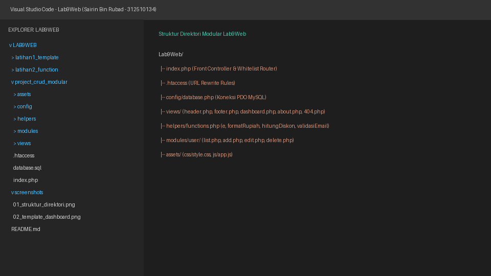
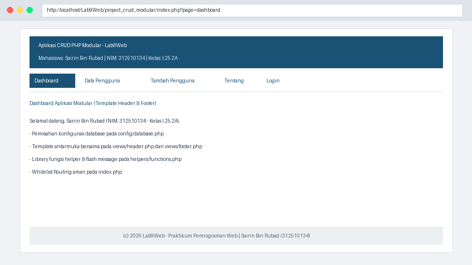
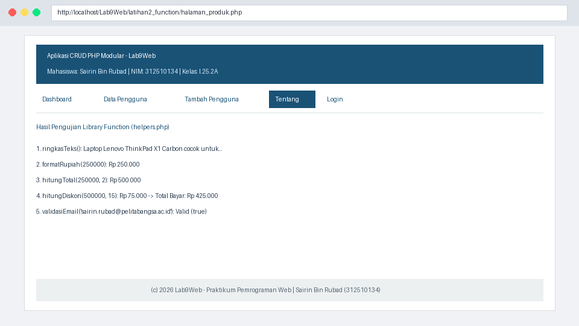
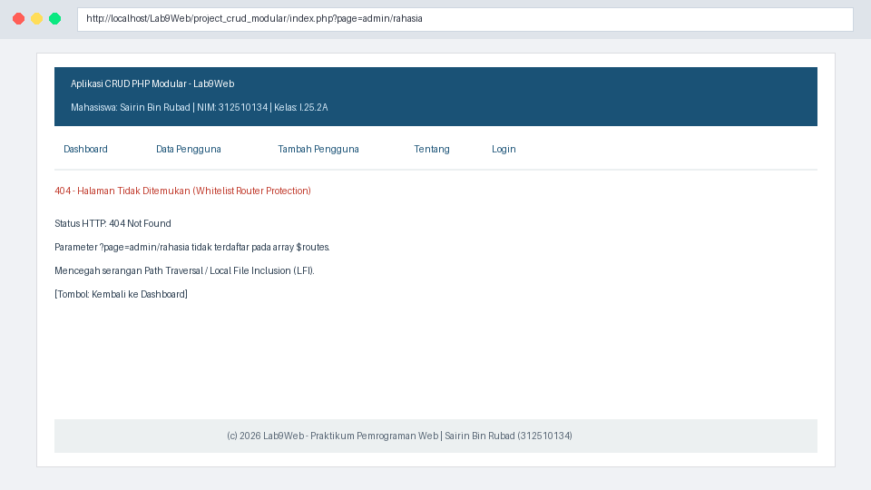
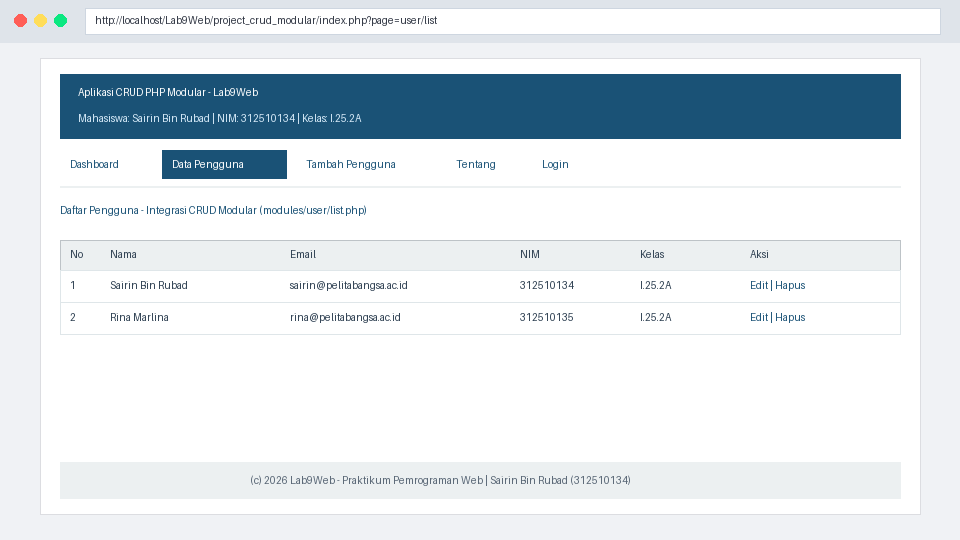

# Lab9Web - Praktikum 9 Pemrograman Web: PHP Modular


* **Nama:** Sairin Bin Rubad
* **NIM:** 312510134
* **Kelas:** I.25.2A
* **Program Studi:** Teknik Informatika — Universitas Pelita Bangsa

---

## 1. Tujuan Project
Project ini bertujuan menerapkan konsep **PHP Modular** dalam pengembangan aplikasi web, meliputi pemisahan kode berdasarkan tanggung jawab (*Separation of Concerns*), penggunaan template bersama (`header.php` & `footer.php`), pembuatan *library function* yang dapat digunakan ulang, penyusunan struktur direktori terstandar, serta implementasi *Whitelist Routing* yang aman pada aplikasi CRUD berbasis database.

## 2. Kebutuhan Perangkat
* **Web Server Lokal:** Apache (XAMPP / Laragon) dengan `mod_rewrite` aktif
* **PHP:** Versi 8.0 atau lebih baru (dengan ekstensi `pdo_mysql`)
* **Database:** MySQL / MariaDB
* **Code Editor:** Visual Studio Code
* **Browser:** Google Chrome / Mozilla Firefox / Microsoft Edge

## 3. Cara Menjalankan Aplikasi
1. Ekstrak dan simpan isi folder `Lab9Web` ke dalam direktori `htdocs` (XAMPP) atau `www` (Laragon), misalnya `C:\xampp\htdocs\Lab9Web`.
2. Jalankan layanan **Apache** dan **MySQL** melalui panel kontrol XAMPP/Laragon.
3. Buka **phpMyAdmin** (`http://localhost/phpmyadmin`), buat database baru bernama `db_latihan`, lalu impor file `project_crud_modular/database.sql`.
4. Sesuaikan kredensial koneksi database jika diperlukan pada file `project_crud_modular/config/database.php`.
5. Akses aplikasi melalui browser:
   * **Latihan 1 (Template):** `http://localhost/Lab9Web/latihan1_template/home.php`
   * **Latihan 2 (Function):** `http://localhost/Lab9Web/latihan2_function/halaman_produk.php`
   * **Project CRUD Modular (Latihan 3 & 4):** `http://localhost/Lab9Web/project_crud_modular/index.php`

## 4. Struktur Direktori
```text
Lab9Web/
├── latihan1_template/              # Latihan 1: Template multi-halaman
│   ├── header.php
│   ├── footer.php
│   ├── home.php
│   ├── profil.php
│   ├── kontak.php
│   └── style.css
├── latihan2_function/              # Latihan 2: Library function & pengujian
│   ├── helpers.php
│   ├── halaman_produk.php
│   └── halaman_akademik.php
├── project_crud_modular/           # Latihan 3, 4 & Tantangan Mandiri
│   ├── index.php                   # Front controller & whitelist router
│   ├── .htaccess                   # Konfigurasi URL rewrite Apache
│   ├── database.sql                # Skema tabel & data awal
│   ├── config/
│   │   └── database.php            # Koneksi database PDO
│   ├── views/
│   │   ├── header.php              # Template header & navigasi aktif
│   │   ├── footer.php              # Template footer
│   │   ├── dashboard.php           # Halaman utama
│   │   ├── about.php               # Halaman tentang
│   │   └── 404.php                 # Halaman error rute tidak ditemukan
│   ├── helpers/
│   │   └── functions.php           # Kumpulan fungsi helper, flash message & CSRF
│   ├── modules/
│   │   ├── user/                   # Modul CRUD pengguna
│   │   │   ├── list.php
│   │   │   ├── add.php
│   │   │   ├── edit.php
│   │   │   └── delete.php
│   │   └── auth/                   # Modul autentikasi sederhana
│   │       ├── login.php
│   │       └── logout.php
│   └── assets/
│       ├── css/style.css
│       └── js/app.js
├── screenshots/                    # Dokumentasi gambar hasil pengujian
│   ├── 01_struktur_direktori.png
│   ├── 02_template_dan_dashboard.png
│   ├── 03_pengujian_function.png
│   ├── 04_routing_404_validation.png
│   └── 05_hasil_crud_modular.png
├── JAWABAN_PERTANYAAN.md           # Jawaban lengkap Bagian D & Bagian L
└── README.md                       # Dokumentasi utama praktikum
```

## 5. Daftar Rute Aplikasi (`project_crud_modular/index.php`)
| Parameter `?page=` | File Modul Tujuan | Keterangan |
| :--- | :--- | :--- |
| `dashboard` (default) | `views/dashboard.php` | Halaman beranda aplikasi |
| `about` | `views/about.php` | Informasi aplikasi & pengujian helper |
| `user/list` | `modules/user/list.php` | Menampilkan seluruh data pengguna (Read) |
| `user/add` | `modules/user/add.php` | Form & proses tambah pengguna (Create) |
| `user/edit` | `modules/user/edit.php` | Form & proses ubah pengguna (Update) |
| `user/delete` | `modules/user/delete.php` | Proses hapus pengguna via POST + CSRF (Delete) |
| `auth/login` | `modules/auth/login.php` | Halaman login sederhana (`admin` / `admin123`) |
| `auth/logout` | `modules/auth/logout.php` | Menghapus sesi login pengguna |
| *(Rute tidak terdaftar)* | `views/404.php` | Mengembalikan status HTTP 404 Not Found |

## 6. Hasil Pengujian & Screenshot Praktikum

### 6.1. Struktur Direktori Modular (`Lab9Web`)
Susunan direktori dipisahkan berdasarkan fungsi (`config`, `views`, `helpers`, `modules`, dan `assets`):



### 6.2. Template Bersama & Dashboard Aplikasi
Halaman menggunakan `views/header.php` dan `views/footer.php` secara konsisten dengan indikator menu aktif dinamis:



### 6.3. Pengujian Library Function (`helpers.php`)
Pengujian fungsi `ringkasTeks()`, `formatRupiah()`, `hitungTotal()`, `hitungDiskon()`, dan `validasiEmail()` yang dipanggil dari file terpisah:



### 6.4. Validasi Whitelist Routing & Halaman 404
Pengujian parameter URL tidak terdaftar (`?page=admin/rahasia`) ditolak secara aman oleh router dengan mengembalikan halaman **404 Not Found**:



### 6.5. Integrasi CRUD Database Modular (`modules/user/list.php`)
Seluruh operasi Create, Read, Update, dan Delete berjalan melalui front controller `index.php`:



## 7. Langkah Praktikum yang Dikerjakan
1. **Pengujian `include` & `require`:** Membandingkan perilaku *Warning* pada `include` dan *Fatal Error* pada `require` ketika file target tidak ditemukan.
2. **Pembuatan Template Layout:** Memisahkan struktur HTML atas (`header.php`) dan bawah (`footer.php`) agar digunakan bersama oleh halaman `home.php`, `profil.php`, dan `kontak.php`.
3. **Pengembangan Library Function:** Membuat fungsi `formatRupiah()`, `hitungDiskon()`, `validasiEmail()`, `ringkasTeks()`, serta fungsi konversi dan predikat nilai di `helpers.php`, lalu memanggilnya pada dua halaman berbeda.
4. **Penyusunan Struktur Modular & Router:** Membangun aplikasi berbasis arsitektur direktori `config/`, `views/`, `helpers/`, `modules/`, dan `assets/` dengan pengendalian navigasi terpusat melalui `index.php`.
5. **Integrasi CRUD & Tantangan Mandiri:** Mengintegrasikan operasi CRUD database ke dalam modul `user`, menambahkan menu aktif dinamis, *flash message* sukses/gagal, proteksi hapus via POST + CSRF, serta aturan `.htaccess`.

## 8. Kendala yang Ditemukan dan Cara Mengatasinya
1. **Error `Failed opening required` saat pemanggilan file lintas direktori:**
   * *Penyebab:* Penggunaan path relatif biasa bergantung pada lokasi direktori kerja skrip pemanggil.
   * *Solusi:* Menggunakan konstanta magic `__DIR__` (misalnya `require_once __DIR__ . '/config/database.php';`) agar path selalu mengacu pada direktori absolut file tersebut berada.
2. **Error `Cannot modify header information - headers already sent` saat proses `header('Location: ...')` pada modul CRUD:**
   * *Penyebab:* File `views/header.php` sudah mencetak tag HTML sebelum proses redirect pada `add.php`/`edit.php`/`delete.php` dijalankan.
   * *Solusi:* Memproses logika `POST` dan aksi `delete`/`logout` di `index.php` sebelum memuat `views/header.php`.
3. **URL Rewrite `.htaccess` menghasilkan error 404 Apache:**
   * *Penyebab:* Modul `mod_rewrite` belum aktif atau `AllowOverride` pada konfigurasi virtual host masih diset `None`.
   * *Solusi:* Mengaktifkan `LoadModule rewrite_module` dan mengubah `AllowOverride All` pada file konfigurasi `httpd.conf` Apache.

---

> **Catatan:** Jawaban lengkap analisis Bagian D dan pertanyaan pemahaman Bagian L tersedia pada file [`JAWABAN_PERTANYAAN.md`](JAWABAN_PERTANYAAN.md).
